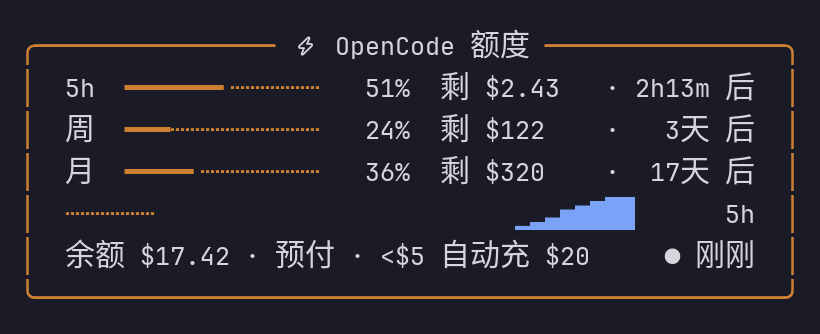

# OpenCode 额度挂件（Hermes TUI Widget）

> **English TL;DR** — A zero-dependency, single-file TUI widget for [Hermes Agent](https://hermes-agent.nousresearch.com) (`hermes --tui`): OpenCode **Go quota** (5h / weekly / monthly windows, progress bars, reset countdowns), a session trend line, and your **Zen wallet balance**. Install: copy `opencode-balance.mjs` into `~/.hermes/tui-widgets/`, run `/widgets-reload` in the TUI, toggle with `/ocbal`. Requires `OPENCODE_GO_API_KEY` and/or `OPENCODE_ZEN_API_KEY` in `~/.hermes/.env`. MIT licensed.

在 Hermes TUI（`hermes --tui`）里常驻显示 **OpenCode Go 订阅额度** 与 **Zen 钱包余额** 的面板挂件。单文件、零依赖、无需构建。

## 功能

- **三窗口用量**：5h / 周 / 月，各一行 —— 细线进度条（主题色分段：50% / 80% / 95% 变色）+ 百分比 + 剩余额度 + 重置倒计时
- **走势图**：分隔线上内嵌本会话 5h 用量 sparkline（金色调）
- **钱包行**：Zen 预付钱包余额（低于 $5 标红）· 计费方式 · 右上角数据新鲜度指示灯（绿 → 黄 >3 分钟 → 红：读取失败，失败时保留上次成功数据并显示「上次成功 N 分钟前」）
- 60 秒自动刷新，15 秒时钟重绘（倒计时跳动）
- 颜色全部取自主题 tone，`/skin` 与明暗主题自动适配



<details>
<summary>文本示意（无图环境）</summary>

```
╭─────────── ⚡ OpenCode 额度 ───────────╮
│ 5h  ━┄┄┄┄┄┄┄┄┄┄┄  12%  剩 $2.85 · 2h14m 后 │
│ 周  ━━━┄┄┄┄┄┄┄┄┄┄  31%  剩 $320 · 3天 后    │
│ 月  ━━━━━━┄┄┄┄┄┄┄  58%  剩 $18 · 12天 后    │
│ ┄┄┄▂▃▅▆▇┄┄┄┄┄┄┄┄┄┄┄┄┄┄┄┄┄  5h            │
│ 余额 $42.00 · 预付 · <$5 自动充 $20  ● 刚刚 │
╰────────────────────────────────────────╯
```

</details>

> 预览图由挂件的无 TUI 预览器渲染，数据为示例值。

## 环境要求

- Hermes Agent（实测于 v0.22.2+1086），必须用 **`hermes --tui`** —— 经典 CLI 和消息平台不渲染挂件
- 一个 OpenCode API key（至少配置下面两个之一）：
  - `OPENCODE_GO_API_KEY` —— Go 订阅额度
  - `OPENCODE_ZEN_API_KEY` —— Zen 钱包余额（两者填一个也能跑，另一个显示为不可用）

## 安装

```bash
bash install.sh
```

或手动：

```bash
cp opencode-balance.mjs ~/.hermes/tui-widgets/
```

然后在**运行中的 TUI** 里执行 `/widgets-reload`。挂件加载后**自动停靠**在状态栏上方（ambient 模式，无需输入）；`/ocbal` 切换显示/收起。

> 自定义 Hermes 主目录的用户：脚本和挂件都尊重 `HERMES_HOME` 环境变量。

## 配置 Key

编辑 `~/.hermes/.env`（或直接 export 环境变量）：

```
OPENCODE_ZEN_API_KEY=你的Zen钱包key
OPENCODE_GO_API_KEY=你的Go订阅key
```

改完在 TUI 里 `/widgets-reload`（挂件内缓存 5 分钟，重载即重读）。

## 卸载

```bash
rm ~/.hermes/tui-widgets/opencode-balance.mjs
```

再执行 `/widgets-reload` 即可消失。

## 数据源

| 接口 | 用途 |
|------|------|
| `GET https://opencode.ai/console/api/go/status` | Go 订阅 5h / 周 / 月 三窗口（meters.access.meters） |
| `GET https://opencode.ai/console/api/billing/status` | Zen 预付钱包余额（balanceMicroCents，单位为万分之一美分，除以 1e8 得美元） |
| `GET https://opencode.ai/zen/go/v1/usage` | 备用：go/status 失败时取三窗口百分比 |

均带 `Authorization: Bearer <key>` 请求头，10 秒超时。密钥读取顺序：`process.env` → `~/.hermes/.env`（支持 `HERMES_HOME` 覆盖路径）。

## 定制

改文件顶部常量后 `/widgets-reload`：

| 常量 | 默认 | 说明 |
|------|------|------|
| `REFRESH_MS` | 60000 | 拉取间隔 |
| `TICK_MS` | 15000 | 时钟重绘（倒计时跳动） |
| `WIDTH` | 52 | 卡片总宽（含边框与内边距） |
| `TITLE` | ` ⚡ OpenCode 额度 ` | 边框内嵌标题 |

## 故障排查

- **显示「额度读取失败」**：先验证 key —— `curl -H "Authorization: Bearer $OPENCODE_GO_API_KEY" https://opencode.ai/console/api/go/status`；HTTP 4xx 换 key，5xx 等 OpenCode 恢复
- **挂件没出现**：确认用的是 `hermes --tui`；`/widgets-reload` 看输出里 `loaded:` 是否列出本文件；仍不出看 `~/.hermes/logs/tui_gateway_crash.log`
- **只显示「Go 订阅额度不可用」**：非 Go 订阅账号的正常表现，钱包余额仍会显示
- **卡片变形/换行**：改过 `WIDTH` 后行宽会重新计算，若手改了行内列宽，注意每行动态字符串都过 `fit()`/`clip()`，别让任何一行超过 `INNER = WIDTH - 6`

## 兼容性说明

依赖 Hermes widget SDK 的 `defineWidgetApp / openWidget / Box / Text / ShimmerRows / sparkline`。上游接口字段变动时，挂件会显示错误提示而非崩溃；widget SDK 是非公开契约，Hermes 大版本升级后如失效请回来更新本包。

## 文件清单

| 文件 | 说明 |
|------|------|
| `opencode-balance.mjs` | 挂件本体（ESM 单文件，id=`ocbal`） |
| `install.sh` | 安装脚本（自动备份旧文件、检查 key 配置） |
| `LICENSE` | MIT |
| `README.md` | 本文件 |
| `docs/preview.png` | 预览图（示例数据） |

版本：v2（2026-10-18），作者 raven，MIT 许可。
