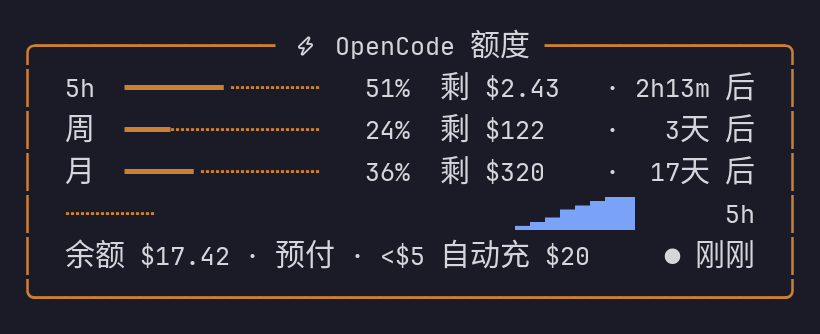

# OpenCode 额度挂件（Hermes TUI Widget）

> **English TL;DR** — A zero-dependency, single-file TUI widget for [Hermes Agent](https://hermes-agent.nousresearch.com) (`hermes --tui`): OpenCode **Go quota** (5h / weekly / monthly windows, progress bars, reset countdowns), a session trend line, and your **Zen wallet balance**. Install: copy `opencode-balance.mjs` into `~/.hermes/tui-widgets/`, run `/widgets-reload` in the TUI, toggle with `/ocbal`. Requires `OPENCODE_GO_API_KEY` and/or `OPENCODE_ZEN_API_KEY` in `~/.hermes/.env`. MIT licensed.

在 Hermes TUI（`hermes --tui`）里常驻显示 **OpenCode Go 订阅额度** 与 **Zen 钱包余额** 的面板挂件。单文件、零依赖、无需构建。

## 功能

- **三窗口用量**：5h / 周 / 月，各一行 —— 细线进度条（主题色分段：50% / 80% / 95% 变色）+ 百分比 + **剩余/上限** + 重置倒计时
- **走势图**：分隔线上内嵌本会话 5h 用量 sparkline（金色调）
- **钱包行**：Zen 预付钱包余额（低于 $5 标红）· 计费方式 · 右上角数据新鲜度指示灯（绿 → 黄 >3 分钟 → 红：读取失败，失败时保留上次成功数据并显示「上次成功 N 分钟前」）
- 60 秒自动刷新，15 秒时钟重绘（倒计时跳动）
- 颜色全部取自主题 tone，`/skin` 与明暗主题自动适配



<details>
<summary>文本示意（无图环境）</summary>

```
╭            ⚡ Go · deepseek-v4.1-flash            ╮
│  5h  ━━┄┄┄┄┄┄┄┄┄   19%  剩 $16/$20     2h58m 后  │
│  周  ━━━━━━━┄┄┄┄   64%  剩 $18/$50       1天 后  │
│  月  ━━━━━━━╸┄┄┄   69%  剩 $31/$100     16天 后  │
│  ┄┄┄┄┄┄┄▂▃▅▆▇┄┄┄┄┄┄┄┄┄┄┄┄┄┄┄┄┄┄┄┄┄┄┄┄┄┄┄┄┄┄┄┄┄  │
│  余额 $16.43 · 预付 · <$5 自动充 $20     ● 刚刚  │
╰──────────────────────────────────────────────────╯
```

</details>

> 上面的卡片由 `scripts/preview.mjs`（无 TUI 预览器）渲染真实接口数据得到；`docs/preview.png` 是 v2 时期的截图。

## 环境要求

- Hermes Agent（实测于 v0.22.2+1086），必须用 **`hermes --tui`** —— 经典 CLI 和消息平台不渲染挂件
- 一个 OpenCode API key（至少配置下面两个之一）：
  - `OPENCODE_GO_API_KEY` —— Go 订阅额度
  - `OPENCODE_ZEN_API_KEY` —— Zen 钱包余额（两者填一个也能跑，另一个显示为不可用）

## 安装

```bash
bash install.sh
```

或手动：

```bash
cp opencode-balance.mjs ~/.hermes/tui-widgets/
```

然后在**运行中的 TUI** 里执行 `/widgets-reload`。挂件加载后**自动停靠**在状态栏上方（ambient 模式，无需输入）；`/ocbal` 切换显示/收起。

> 自定义 Hermes 主目录的用户：脚本和挂件都尊重 `HERMES_HOME` 环境变量。

## 配置 Key

编辑 `~/.hermes/.env`（或直接 export 环境变量）：

```
OPENCODE_ZEN_API_KEY=你的Zen钱包key
OPENCODE_GO_API_KEY=你的Go订阅key
```

改完在 TUI 里 `/widgets-reload`（挂件内缓存 5 分钟，重载即重读）。

## 卸载

```bash
rm ~/.hermes/tui-widgets/opencode-balance.mjs
```

再执行 `/widgets-reload` 即可消失。

## 数据源

| 接口 | 用途 |
|------|------|
| `GET https://opencode.ai/zen/go/v1/usage` | **三窗口百分比（权威）**：rolling / weekly / monthly 的 percent 与 resetsAt |
| `GET https://opencode.ai/console/api/go/status` | Go 订阅窗口起止、meters 美元（旧账户池口径，仅作回退） |
| `GET https://opencode.ai/console/api/billing/status` | Zen 预付钱包余额（balanceMicroCents，单位为万分之一美分，除以 1e8 得美元） |
| `GET https://opencode.ai/go` | 各模型 Go / Go Plus **月度额度表**（6 小时缓存到 `~/.hermes/cache/ocbal-go-limits.json`） |

均带 `Authorization: Bearer <key>` 请求头，10 秒超时。密钥读取顺序：`process.env` → `~/.hermes/.env`（支持 `HERMES_HOME` 覆盖路径）。

## 额度口径（v3 起）

2026-10 起 Go 改成**按模型计量**：每个模型有自己的月度美元额度（如 DeepSeek V4.1 Flash = $100/月，Go Plus = $200），
三个窗口是月限的比例：**5h = 20%、周 = 50%、月 = 100%**。

问题在于 `console/api/go/status` 的 `meters` 美元仍是旧的 $60 账户池口径（DeepSeek 会显示「剩 $10.17」这种明显偏小的数），
**百分比才是真实占用**。所以挂件：

- 百分比取 `zen/go/v1/usage`（服务端权威值）；
- 美元按「当前模型月限 × 窗口比例」换算，行的格式为 `剩 $16/$20`；
- 卡片标题显示当前模型与**来源标记**（`⚡ Go · deepseek-v4.1-flash [db]`）。判定顺序：
  0. `/ocbal model=<id>` 手动锁定（`[lock]`，最可靠；`/ocbal model=auto` 解除）——多窗口时用这个
  1. `HERMES_INFERENCE_MODEL` / `HERMES_MODEL` 环境变量（`[env]`，也能用来预览别的模型额度）
  2. `~/.hermes/state.db` 里**最近活跃会话**的 model（`[db]`）—— TUI 的 `/model` 切换是会话级，
     不写 config.yaml 也不写进程 env（见 `tui_gateway/model_switch.py`），只能读库
  3. `~/.hermes/config.yaml` 的 `model.default`（`[config]`，老版本 / 无 state.db 时）
- 模型每 **5 秒**检测一次（只读 state.db，约 7ms），额度接口仍 60 秒一拉；模型变化立刻重渲染。
- 模型月限来自官网表格，抓不到时用内置兜底表；两者都不命中（未知模型）则回退成服务端池口径的 `剩 $x.xx`。

**为什么做不到「秒跟随」**（两条都是 Hermes 侧的限制，不是挂件能绕过的）：

- widget SDK 的 `render(ctx)` 只给 `cols / rows / state / t`，**拿不到本窗口的 session id**，
  所以只能靠「最近活跃会话」猜当前模型——同时开多个窗口、且在别的窗口切模型时会读错；
- `/model` 在流式输出期间是 **pending** 的（下一轮 turn 开始才应用并写库），此时连 Hermes 自己的
  footer 都还显示旧模型，挂件自然也读不到新值。

**精度说明**：`zen/go/v1/usage` 的 percent 是**账户级综合百分比**（Go 把各模型额度按扣费归一成一个池），
不是按模型分开计的两个数。所以美元数字是「按当前模型月限换算的等价额度」——只用一个模型时准确，
混用多个模型时是近似值。同时开多个 live 会话时，取最近活动的那个会话的模型，不一定是你正在看的窗口。

## 额度调了要不要改代码

| 变化 | 是否自动 | 说明 |
|------|---------|------|
| 某个模型的月限调数值（如 $100 → $120） | ✅ 自动，1 小时内 | 每 1h 重抓 `opencode.ai/go` 额度表 |
| 新增 / 下架模型 | ✅ 自动 | 表里出现即生效，`capOf` 按规范化名匹配 |
| 升级到 Go Plus / Teams | ✅ 自动 | 按 `go/status` 的 `product` 字段切到额度表第二列 |
| 抓表失败 / 断网 | ⚠️ 用内置兜底表 | 卡片底部会标 `额度表离线 · 内置值`；抓回来自动恢复 |
| 窗口结构变化（加 daily、改比例） | ❌ 需改代码 | 现在是写死的 `fiveHour / weekly / monthly` + `20% / 50% / 100%` |
| percent 从「账户综合池」改成按模型分开计 | ❌ 需改代码 | 现在只有一个综合百分比，见上面的精度说明 |
| `go/status`、`zen/go/v1/usage` 字段改名 | ❌ 需改代码 | 字段缺失时挂件显示「额度不可用」而不是崩溃 |

内置兜底表（`LIMIT_FALLBACK`）是 2026-10-31 的快照，只在抓不到官网且本地无缓存时兜底——它的过期不会覆盖网络值。


## 定制

改文件顶部常量后 `/widgets-reload`：

| 常量 | 默认 | 说明 |
|------|------|------|
| `REFRESH_MS` | 60000 | 拉取间隔 |
| `TICK_MS` | 15000 | 时钟重绘（倒计时跳动） |
| `WIDTH` | 52 | 卡片总宽（含边框与内边距） |
| `BAR_W` | 11 | 进度条列宽 |
| `REMAIN_W` | 14 | 「剩 $x/$y」列宽（最宽为 `剩 $2.43/$3.00`） |
| `LIMIT_TTL` | 3600000 | 模型额度表缓存时长（1h，官网调额度后自动跟上） |
| `TITLE` | ` ⚡ OpenCode 额度 ` | 无模型额度时的边框内嵌标题 |

## 故障排查

- **显示「额度读取失败」**：先验证 key —— `curl -H "Authorization: Bearer $OPENCODE_GO_API_KEY" https://opencode.ai/console/api/go/status`；HTTP 4xx 换 key，5xx 等 OpenCode 恢复
- **挂件没出现**：确认用的是 `hermes --tui`；`/widgets-reload` 看输出里 `loaded:` 是否列出本文件；仍不出看 `~/.hermes/logs/tui_gateway_crash.log`
- **只显示「Go 订阅额度不可用」**：非 Go 订阅账号的正常表现，钱包余额仍会显示
- **剩余美元看着比官网小**：说明模型月限没查到（标题里没有模型名），检查 `~/.hermes/cache/ocbal-go-limits.json` 是否生成；删掉它会在下次刷新时重抓
- **卡片变形/换行**：改过 `WIDTH` 后行宽会重新计算，若手改了行内列宽，注意每行动态字符串都过 `fit()`/`clip()`，别让任何一行超过 `INNER = WIDTH - 6`

## 兼容性说明

依赖 Hermes widget SDK 的 `defineWidgetApp / openWidget / Box / Text / ShimmerRows / sparkline`。上游接口字段变动时，挂件会显示错误提示而非崩溃；widget SDK 是非公开契约，Hermes 大版本升级后如失效请回来更新本包。

实测环境：Hermes v0.22.5（2026-10-31）。

## 文件清单

| 文件 | 说明 |
|------|------|
| `opencode-balance.mjs` | 挂件本体（ESM 单文件，id=`ocbal`） |
| `scripts/preview.mjs` | 无 TUI 预览器：渲染挂件真实代码路径并打印卡片（`node scripts/preview.mjs`） |
| `install.sh` | 安装脚本（自动备份旧文件、检查 key 配置） |
| `LICENSE` | MIT |
| `README.md` | 本文件 |
| `docs/preview.png` | 预览图（v2 示例数据，版式以文本示意为准） |

版本：v3（2026-10-31，Go 按模型额度换算），作者 raven，MIT 许可。
